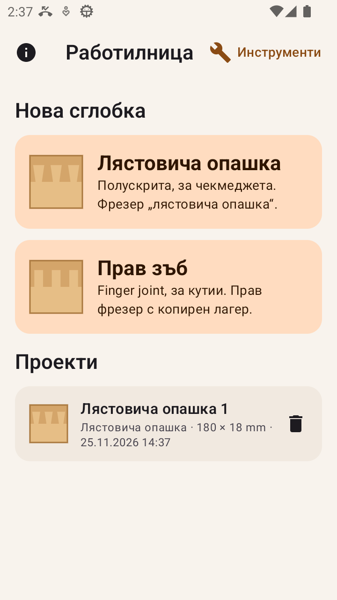
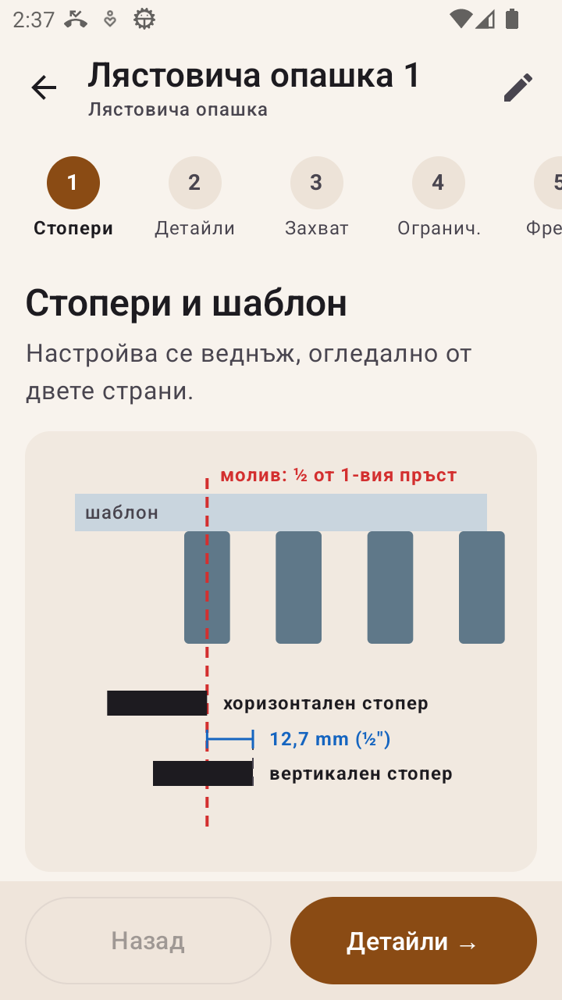
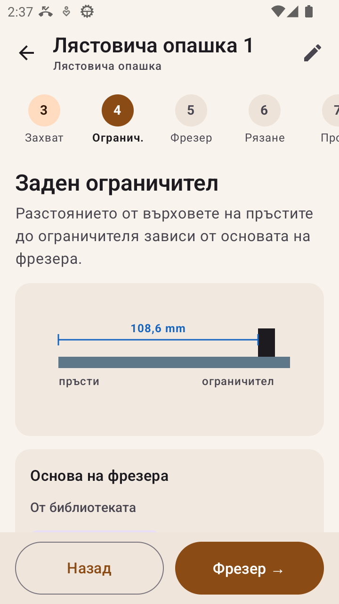
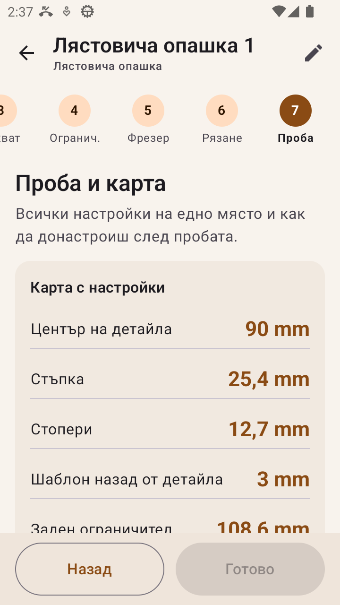
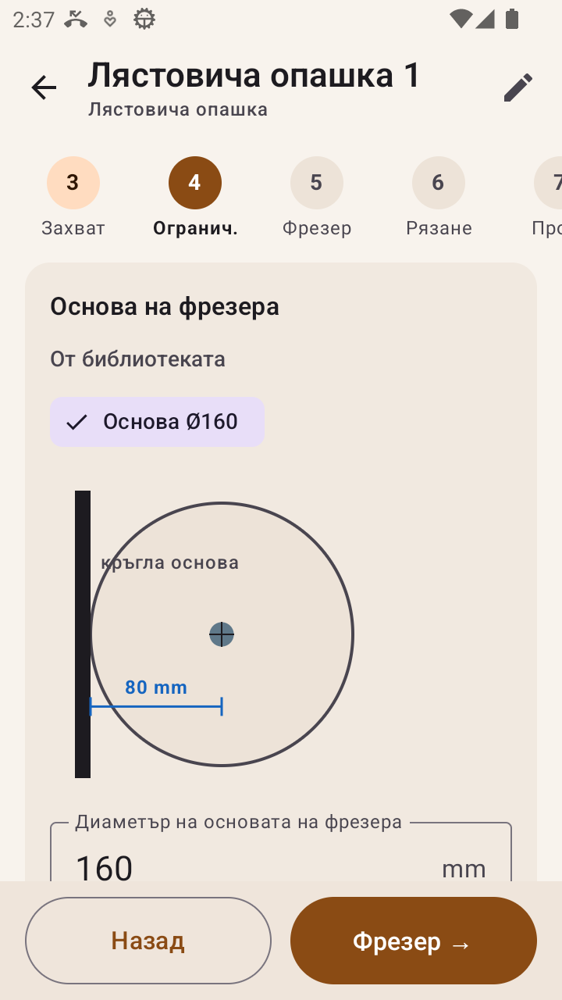
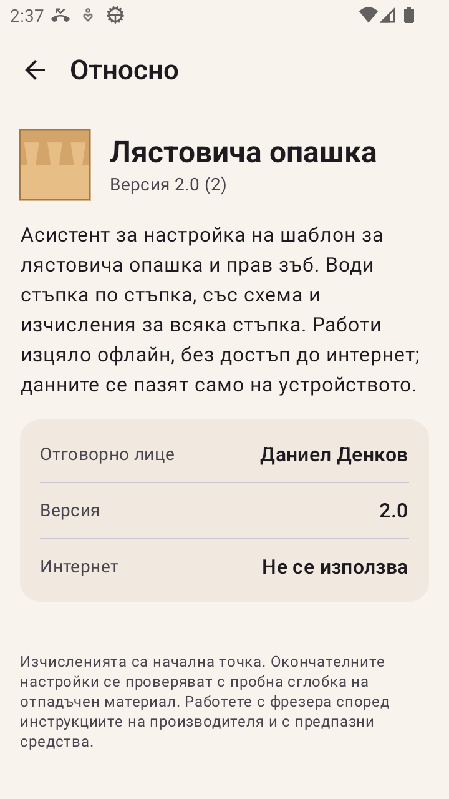
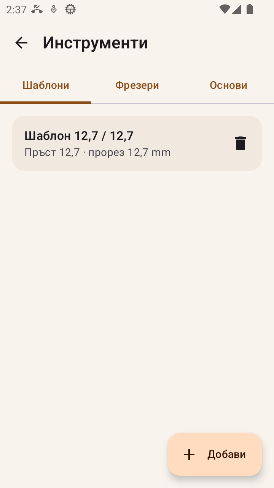

# Лястовича опашка — Android Kotlin
Асистент за настройка на шаблон за лястовича опашка. Води стъпка по стъпка по реда на ръководството на шаблона, със схема за всяка стъпка. Изцяло офлайн, без разрешение за интернет.

**Отговорно лице:** Даниел Денков

**Изтегляне:** готовият APK е в раздел [Releases](../../releases).

## Екрани
| Начало | Стъпка 1 | Заден ограничител | Карта с настройки |
|---|---|---|---|
|  |  |  |  |

| Основа на фрезера | Относно | Инструменти |
|---|---|---|
|  |  |  |

Отвори папката в Android Studio (JDK 17+, compileSdk 35). Gradle wrapper 9.6.0, AGP 8.7.3, Kotlin 2.2.21, Jetpack Compose.

```
gradlew assembleDebug            # APK в app/build/outputs/apk/debug/
gradlew :core:geometry:test      # тестове на математиката
```

## Структура
- `core/geometry` — чист Kotlin, без Android. Цялата математика + unit тестове. Функциите връщат `Calc<T>` (`Ok` / `Invalid` / `NeedsInput`), никога текст.
- `app/.../ui/setup` — `SetupViewModel` (едно `StateFlow`) и екраните на стъпките.
- `app/.../ui/diagram` — схемите (Compose Canvas).
- `app/.../ui/components` — общи елементи и всички текстове за причини и предупреждения.

## Стъпки
1. Стопери и шаблон — молив по средата на 1-вия пръст, вертикалният стопер е ½" вдясно.
2. Детайли — ширина (кратна на ½" за изцяло оформени опашки), центриране, номериране 1–4.
3. Закрепване — двата детайла наравно под шаблона, пръстите 3 mm назад.
4. Заден ограничител — `R + 2t − d/2` (пример от ръководството: 160 / 18 / 14,8 → 108,6 mm).
5. Фрезер и дълбочина — начално 10–11 mm под пръстите, остатъчна стена, профил на конуса.
6. Рязане — лек проход отдясно наляво, след това навътре-навън отляво надясно.
7. Проба и карта — всички настройки и фина настройка.

Ъгълът е спрямо оста, не пълният ъгъл на конуса. Дълбочината 10–11 mm е начална точка; окончателната се определя с пробна сглобка.
